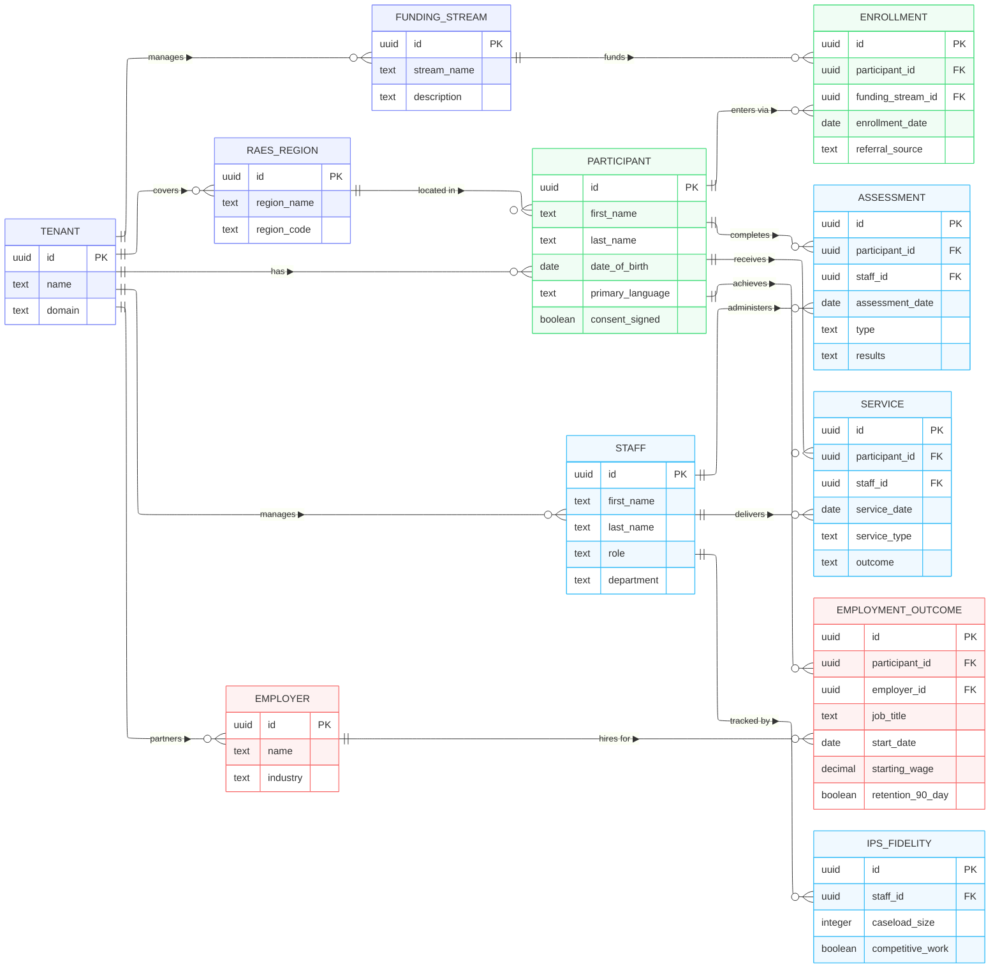

**Product Requirements Document (PRD) – Version 2.0**  
**Product Name:** ImpactForge (General Platform)  
**Flagship Vertical Template:** TSRG Workforce Development Platform (Spring Transits implementation)  
**Date:** April 2026  
**Status:** Merged & Refined – Ready for Development Kickoff  

This v2.0 fully merges the provided TSRG/Spring Transits rudimentary PRD into the Apricot-inspired ImpactForge framework. ImpactForge remains the flexible, multi-tenant core platform; the TSRG Workforce Development vertical is now the **first production-ready template** (pre-loaded forms, assessments, RFE database, Protected Data Zones, HIPAA/42 CFR Part 2 handling, Medicaid/IPS reporting paths). This allows a general SaaS launch **and** an immediate pilot deployment with TSRG.

### 1. Executive Summary & Product Vision
**Vision**: A modern, HIPAA-compliant, cloud-native case management platform that replaces fragmented spreadsheets and legacy tools (including Bonterra Apricot) for nonprofits and human services organizations.  

**Mission**: Deliver intuitive participant tracking, customizable workflows, outcomes measurement, and funder-ready reporting — with out-of-the-box vertical templates that accelerate time-to-value.  

**Flagship Vertical**: TSRG Workforce Development Platform  
- Bridges the “post-treatment cliff” for individuals with substance use disorder and/or criminal-legal involvement.  
- Ingests EHR data, runs standardized assessments, generates individualized Workforce Development Plans, matches to Recovery-Friendly Employers (RFEs), and supports Medicaid-reimbursable case management + future IPS requirements.  
- Initial pilot: Metro Denver/Colorado with 3 BHA-certified providers; designed for nationwide scaling.

**Key Differentiators**  
- Mobile-first UX + participant PWA (white-label capable).  
- Built-in Protected vs. Application Data Zones for HIPAA + 42 CFR Part 2 compliance.  
- AI-assisted insights and conversational reporting (Pro/Enterprise).  
- Self-serve vertical templates (Workforce Development, Youth Services, Housing, etc.) for <30-minute onboarding.

**Target Market**  
- Nonprofits, behavioral health agencies, workforce development programs, reentry services, and public sector (initial focus: Colorado pilot → national scale).  
- Scalable from 5 users (small agency) to 1,000+ across multiple providers/sites.

**Business Objectives** (merged from both PRDs)  
1. Fill the post-treatment cliff with concrete employment pathways.  
2. Enable Medicaid-reimbursable case management and IPS readiness.  
3. Prepare for 2027 work-requirement landscape (80 hours/month).  
4. Build a scalable, licensable product that can replace or complement Apricot.  
5. Achieve strong pilot outcomes to drive paid adoption.

**Success Metrics** (Phase 1 Pilot)  
- No active partner agencies onboarded (target: 3).  
- % of participants with documented Workforce Plan within 30 days of referral.  
- % of participants placed in employment/training within target window.  
- Zero critical HIPAA/42 CFR Part 2 violations.  
- 99.5% uptime; <2s page-load times.

### 2. Target Users & Personas (Merged)
1. **Participant** – Exiting treatment/jail, on Medicaid, needs job/training path.  
2. **Provider Case Manager / Clinician** (BHA-certified agency) – Refers participants, views high-level progress.  
3. **TSRG Workforce Specialist / Coach** – Daily user: intake, assessments, plans, employer matching.  
4. **TSRG / Spring Transits Admin / Program Lead** – Cross-program visibility, reporting, grant/funder prep.  
5. **General Non-Profit Case Worker / Program Manager** (future verticals).

### 3. Scope (Updated with TSRG Pilot)
**In Scope – Phase 1 (Pilot / Core MVP)**  
- HIPAA-compliant backend with **Protected Data Zone** (PII + 42 CFR Part 2) and **Application Data Zone** (de-identified).  
- EHR subset ingestion (CSV/API, read-only).  
- Digital TSRG assessments (3 tools) + Workforce Development Plans.  
- Recovery-Friendly Employer (RFE) directory (~137 seeded).  
- Staff web app + Participant mobile/PWA.  
- Basic reporting & Medicaid encounter exports.  
- Vertical template “TSRG Workforce Development” pre-loaded.

**Out of Scope – Phase 1**  
- Full IPS fidelity workflows, automated Medicaid billing, write-back to EHRs, external job-board integrations.

## 9. Data Model & Architecture

### Overview
The ImpactForge data model is designed to support high-compliance workforce development workflows. It strictly separates sensitive PII/PHI (Protected Zone) from operational and reporting data (Application Zone), following a Three-Schema PostgreSQL architecture (`public`, `protected`, `application`).

### Core Entities
- **Participant**: The central actor, storing recovery status and encrypted demographics (in `protected` schema).
- **Enrollment & Discharge**: Tracks the formal entry and exit of participants, including eligibility and reasons for discharge.
- **Assessments**: Captures multi-dimensional tools (Skills, Interests, Barriers) with automated scoring and key findings.
- **Services & Training**: Logs engagement in workforce development activities, skill building, and Medicaid-reimbursable encounters.
- **Employment Outcomes**: Measures the ultimate success metric—long-term job stability, wages, and retention milestones.
- **Employers**: A directory of Recovery-Friendly Employers (RFEs) and community partners.

### Entity-Relationship Diagram (ERD)

### Design Decisions & Assumptions
- **Three-Schema Isolation**: Ensures HIPAA/42 CFR Part 2 compliance by isolating PHI in the `protected` schema.
- **Multi-tenancy via RLS**: Every table includes a `tenant_id` column and uses Row-Level Security (RLS) to ensure data isolation.
- **JSONB for Extensibility**: Demographic fields, assessment responses, and retention milestones use JSONB to accommodate evolving standards without frequent migrations.
- **Surrogate IDs**: Cross-zone references (e.g., from `application` to `protected`) use surrogate UUIDs to minimize PHI exposure in operational tables.

### 4. Functional Requirements – User Stories (v2.0)
All stories are now developer-ready with **detailed Acceptance Criteria** for the new TSRG-specific stories. Story-point estimates (Fibonacci scale) are provided **only for new TSRG-specific stories** as requested. Core stories retain previous structure; new/TSRG stories are marked **★ NEW**.

#### 4.1 Core Features – User Stories (MVP / Essentials Tier + TSRG Pilot)

| Module | User Story | Acceptance Criteria (TSRG-specific only) | Story Points (new TSRG only) |
|--------|------------|------------------------------------------|------------------------------|
| **Authentication & Security** | As an Admin, I want to create custom roles with field-level permissions and Protected Data Zone controls so that only authorized staff see PHI or 42 CFR Part 2 data. | ★ NEW – Roles must enforce Protected vs. Application zone separation; audit log every PHI access. | 8 |
| **Org & Program Setup** | As a TSRG Admin, I want a self-serve wizard to configure a “Workforce Development” program with pre-loaded templates (intake, 3 TSRG assessments, RFE directory) so we launch a pilot in <30 minutes. | ★ NEW – Template includes 3 assessments, RFE seed data, and default workflows. | 5 |
| **Referral & Intake** | As a Provider Case Manager, I want to refer a participant to TSRG Workforce services with a single secure feed so that the participant record appears automatically. | ★ NEW – Support CSV upload + future API; auto-map to canonical fields; referral status (Pending → Active). | 13 |
| **Referral & Intake** | As a TSRG Workforce Specialist, I want automatic duplicate detection and referral status tracking (Pending → Active → Completed). | ★ NEW – Fuzzy search on name/DOB; source tracking (jail/court/self). | 5 |
| **Participant/Participant Management** | As a Case Worker, I want a 360° participant timeline that includes intake, assessments, workforce plan, and encounter notes. | – | – |
| **Forms & Data Capture** | As a Workforce Specialist, I want the three existing TSRG assessment tools available as mobile + web digital forms with auto-scoring. | ★ NEW – Raw responses stored in Protected zone; computed summaries (interests/aptitudes/barriers) in Application zone; multiple instances per participant. | 8 |
| **Case & Service Management** | As a TSRG Workforce Specialist, I want to create and update an individualized Workforce Development Plan (short-term + long-term goals + actionable steps). | ★ NEW – Link to training/employers/volunteering; task owner, due date, status; participant-visible subset. | 8 |
| **Case & Service Management** | As a Participant, I want to view my Workforce Plan and mark tasks complete from my phone. | ★ NEW – PWA view; read-only plan + task checkboxes; audit trail of participant updates. | 5 |
| **Recovery-Friendly Employers** | As a Workforce Specialist, I want a searchable directory of Recovery-Friendly Employers with filters (sector, location, trainee readiness). | ★ NEW – Seed 137 employers; fields: name, sector, locations, RFE status, notes; link participants to applications/outcomes (hired/not hired). | 8 |
| **Basic Reporting & Analytics** | As a Program Lead, I want exports for Medicaid encounter billing, grant reports, and early IPS-style metrics. | ★ NEW – Encounter log (date, duration, staff, participant ID); de-identified aggregates; placement rate, hours worked. | 8 |

#### 4.2 Advanced Features – User Stories (Pro + Enterprise)

| Module | User Story | Tier | Acceptance Criteria (TSRG-specific) | Story Points |
|--------|------------|------|-------------------------------------|--------------|
| **Smart Forms & Workflows** | As a Workforce Specialist, I want automated workflows (referral → assessment → plan → employer match). | Pro | ★ NEW – Conditional branching; auto-task creation. | 13 |
| **Scheduling & Referrals** | As a Workforce Specialist, I want calendar invites and RFE application tracking visible to participant & staff. | Pro | – | – |
| **Participant Engagement** | As a Participant, I want a branded mobile PWA (TSRG or partner Workforce Center) with assessments, plan view, tasks, and self-check-ins. | Pro | ★ NEW – White-label branding; gentle reminders. | 8 |
| **Advanced Reporting & BI** | As a Program Manager, I want conversational AI (“Show placement rates by sector for participants who completed all assessments”). | Enterprise | ★ NEW – IPS-style metrics + 2027 work-requirement readiness. | 13 |
| **Integrations & API** | As an IT Lead, I want secure ingestion from multiple EHRs with 42 CFR Part 2 consent capture. | Enterprise | ★ NEW – Mapping layer per provider; future write-back path. | 13 |

**Cross-Cutting Stories** (Core + Advanced)  
- Clear separation of Protected vs. Application Data Zones.  
- Bulk import of RFE lists and referrals.

### 5. Non-Functional Requirements (Strengthened)
- **Compliance**: HIPAA-aligned from Day 1; 42 CFR Part 2 consent flows and data segregation; Protected/Application Data Zones.  
- **Security**: Encryption at rest/transit; RBAC + least privilege; full audit logs.  
- **Performance**: <2s response time; 99.5% uptime (pilot).  
- **Scalability**: Multi-tenant; ready for additional providers/states.  
- **Extensibility**: Data model supports future IPS fields and additional vertical templates.

### 6. Phasing & Milestones (Aligned with TSRG PRD)
**Phase 0 – Discovery & Design** (4–6 weeks): Final data model, HIPAA blueprint, first provider integration specs.  
**Phase 1 – MVP Pilot** (3–4 months): Core backend + data zones + web app + minimal participant PWA + EHR ingestion (1 provider) + RFE directory.  
**Phase 2 – Expansion & IPS-Readiness**: Additional providers, deeper reporting, full participant UX, volunteer tracking.  

### 7. Architecture & Infrastructure Direction
- Hosted under Spring Transits (Azure HIPAA blueprint).  
- Two-tier data store (Protected vs. Application).  
- Frontend: Next.js web + PWA.  
- Backend: NestJS/FastAPI + PostgreSQL (JSONB).  
- Integrations: ETL/API layer for EHRs (read-only Phase 1).

### 8. Dependencies & Open Questions
- Final approved EHR data fields (legal review).  
- Provider staff visibility levels.

