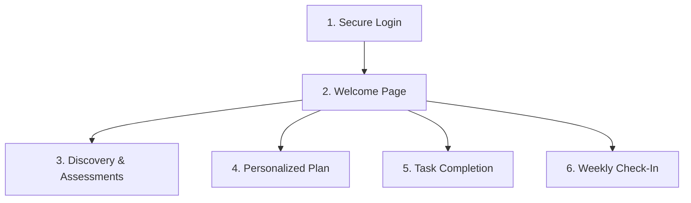

# Participant Digital Journey

This document describes the end-to-end digital experience for participants in the **Gateway2Work** (ImpactForge) platform. Designed for mobile-first PWA delivery, the journey guides participants from secure onboarding to long-term career success.

---

## 1. Journey Architecture & Flow

The participant journey is divided into five key milestones:

### Stage 1: Secure Onboarding
* **Entry**: Secure partner referral via Case Manager.
* **Access**: Password-based login with privacy-first Tenant-level Row Level Security (RLS) protections.
* **Greeting**: Upon login, participants land on the **Participant Welcome Page** to ease anxiety and introduce their dashboard.

### Stage 2: Discover & Assess
* **TSRG Three Assessments**: Standardized questionnaires that map a participant's:
  1. **Skills** (Practical capabilities)
  2. **Interests** (Desired environments)
  3. **Barriers** (Support needs like housing, legal, transportation)
* **Outcomes**: Form responses score automatically to generate a holistic readiness profile.

### Stage 3: The Plan (Roadmap)
* **Individualized Workforce Plan**: Prepared collaboratively with a Workforce Specialist.
* **Goals**: Clear division of Long-Term Goals (e.g., healthcare certification) and Short-Term Milestones.
* **Visibility**: Participants view their active roadmap directly on their phones.

### Stage 4: Tasks (Action Items)
* **Engagement**: Dynamic, interactive list of tasks owned by the participant (e.g., attending a workshop, securing transit pass).
* **Interactivity**: Ability to check tasks off on-the-go to keep the support network updated in real-time.

### Stage 5: Weekly Support (Check-Ins)
* **Holistic Support**: Self-reported weekly health/mood check-in using a simple emoji scale.
* **Feedback Loops**: Flags any direct issues (legal, housing, food security) immediately to their Workforce Specialist.

---

## 2. The Participant Welcome Page

The **Participant Welcome Page** (`/welcome`) is the designated digital front door of the Gateway2Work platform. It serves three primary functions:
1. **Welcome & Orientation**: Welcomes the participant by name and sets a warm, supportive tone.
2. **Current Status Overview**: Displays quick status highlights (e.g., plan status, pending tasks, check-in prompts).
3. **Direct Navigation Paths**: Provides clear, prominent call-to-action cards leading to:
   * **My Plan** (`/plan`): View goals and active roadmap.
   * **My Tasks** (`/tasks`): Stay organized and check off due items.
   * **Weekly Check-In** (`/check-in`): Report on weekly progress and request immediate support.

---

## 3. UI/UX Principles for Participant Views

* **Mobile-First Responsive Design**: Optimized for any smartphone browser.
* **Simple Navigation**: Bottom tab navigation bar with clear icons for easy, persistent access.
* **Warm and Clean Aesthetics**: Soft blue accents, clear typography, and supportive copy to reduce cognitive and emotional stress.
